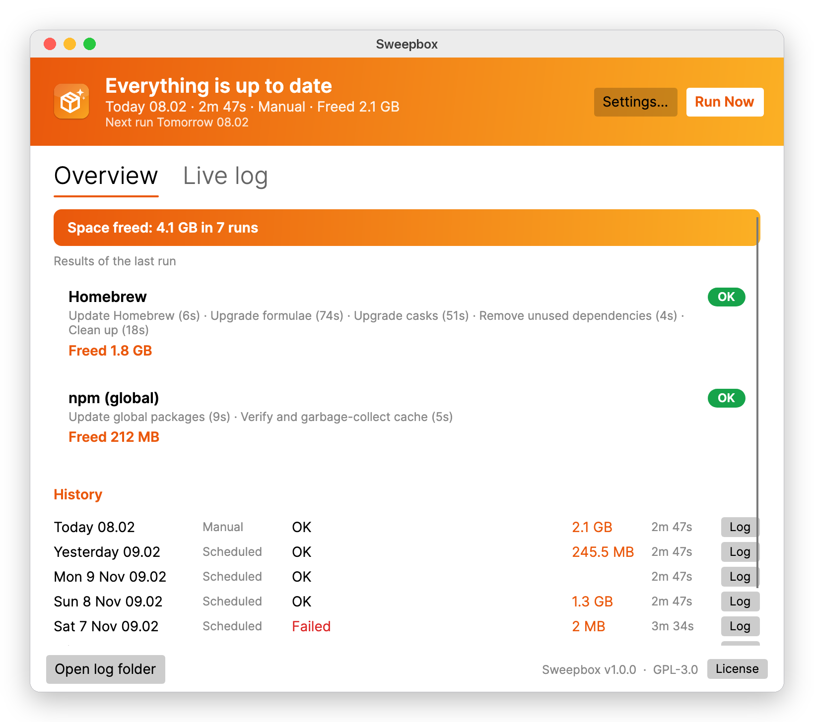

<p align="center"></p>

# Sweepbox

A small menu bar (macOS) / system tray (Windows) app that keeps your package managers up to date and tidy on a schedule, and shows how much disk space the clean-up saved.

<picture>
  <source media="(prefers-color-scheme: dark)" srcset="docs/images/status-macos-dark.png">
  
</picture>

**[Website](https://molsted.github.io/sweepbox/)** · **[Download the latest release](https://github.com/molsted/sweepbox/releases/latest)** · **[Manual](https://molsted.github.io/sweepbox/docs.html)** ([Markdown](docs/MANUAL.md))

| Manager    | Platform      | What it does (each step can be switched off)                                                                  |
|------------|---------------|---------------------------------------------------------------------------------------------------------------|
| Homebrew   | macOS         | `brew update` → `upgrade --formula` → `upgrade --cask [--greedy]` → `autoremove` → `cleanup [--prune=all]`   |
| Chocolatey | Windows       | `choco upgrade all -y [--except=…]` → `choco cache remove`                                                    |
| npm        | macOS/Windows | `npm update -g` → `npm cache verify` (or `npm cache clean --force`)                                           |

## Features

- **Runs on an interval** (default every 24 h). It checks once a minute, so a run that was missed while the computer slept starts soon after wake-up. A start delay keeps it from running the moment you log in.
- **Status in the menu bar / tray**: an icon that changes for idle, running and failed. The menu shows the last and next run and has Run Now, Run Only ▸ (one manager), Cancel, Pause Schedule, Status and Log, and Settings.
- **Settings window**: interval, per-manager steps, Chocolatey exclusions, npm cache mode, start at login, notifications, step timeout and extra PATH entries.
- **Space freed**: cleanup steps measure the cache/old-version folders before and after, and show the result per manager, per run and as a running total. Shown only when cleanup is enabled.
- **Status window**: per-manager results, run history, a live log, and links to each run's log file.
- **Finds your tools the way your terminal does**: on macOS it reads the PATH from your login shell, so Homebrew, nvm, volta and fnm installs are found even when the app is started from Finder.
- **Never hangs on prompts**: stdin is closed and every command has a timeout. Anything that asks for a password fails and is reported, instead of blocking.
- **Chocolatey needs admin rights**: if the app isn't elevated, it asks for UAC once per command (can be turned off in Settings).
- Native notifications on failure (and on success, if you opt in). Only one instance runs at a time.

## Install

Download from the build artifacts / GitHub release:

- **macOS**: `Sweepbox-<ver>-macos-arm64.dmg` (Apple Silicon) or `-x64.dmg` (Intel). Drag the app to Applications.
  Local builds are ad-hoc signed. The first time, right-click the app → **Open**, or run `xattr -dr com.apple.quarantine /Applications/Sweepbox.app`.
- **Windows**: `Sweepbox-<ver>-windows-x64-setup.exe` (or `arm64`). It installs per user by default, without needing admin.

## Command line

```
Sweepbox --dry-run   # show which commands would run and where each tool was found
Sweepbox --run       # one headless run (exit code 0 = success), e.g. for your own cron job
```

On macOS the binary is `/Applications/Sweepbox.app/Contents/MacOS/Sweepbox`.

## Files

| | macOS | Windows |
|---|---|---|
| Settings, history | `~/Library/Application Support/Sweepbox/` | `%APPDATA%\Sweepbox\` |
| Run logs (last 60) | `…/Sweepbox/logs/` | `…\Sweepbox\logs\` |
| Start at login | `~/Library/LaunchAgents/dk.sweepbox.agent.plist` | `HKCU\…\CurrentVersion\Run\Sweepbox` |

## Development

Requirements: .NET 10 SDK. Python 3 with Pillow is only needed to regenerate graphics.

```bash
dotnet run --project src/Sweepbox.Desktop    # run the app
dotnet test                                     # unit tests
python3 tools/generate_icons.py                 # regenerate all icons/installer graphics
dotnet run --project tools/Screenshots -- docs/images/raw && python3 tools/frame_screenshots.py   # manual screenshots
python3 tools/generate_site_graphics.py         # website hero, social card, favicons
pip install markdown==3.7 && python3 tools/build_site.py   # website -> _site/
```

```
src/Sweepbox.Core       Settings, package managers, command runner, engine, scheduler (no UI)
src/Sweepbox.Desktop    Avalonia UI: tray/menu bar, settings + status windows, CLI entry point
tests/Sweepbox.Tests    xUnit tests
tools/generate_icons.py   Draws the app icon, tray icons, DMG background and installer bitmaps
tools/Screenshots         Renders the real windows off-screen (Avalonia headless) for the manual
tools/frame_screenshots.py  Adds window chrome to those renders and draws the menu illustrations
docs/                     The manual and its images
site/                     GitHub Pages website (landing page, layout for the docs and license pages)
tools/build_site.py       Builds the website: renders docs/MANUAL.md and LICENSE into it
installer/macos           Info.plist, entitlements, .icns + Icon Composer icon, DMG background
installer/windows         Inno Setup script, .ico, wizard images
scripts/                  package-macos.sh, make-dmg.sh, package-windows.ps1
```

### Building installers

**macOS** (on a Mac):

```bash
scripts/package-macos.sh                       # → artifacts/Sweepbox-<ver>-macos-{arm64,x64}.dmg
```

With Xcode 26 installed, the script compiles `installer/macos/AppIcon.icon` (Icon Composer) into the app so macOS 26 shows the icon natively. Without Xcode it falls back to the classic `.icns`, which macOS 26 displays inside a grey frame. CI selects Xcode 26 automatically.

For distribution, sign with a Developer ID and notarize:

```bash
SIGN_IDENTITY="Developer ID Application: Your Name (TEAMID)" NOTARY_PROFILE=myprofile scripts/package-macos.sh
```

**Windows** (on Windows, with [Inno Setup 6](https://jrsoftware.org/isinfo.php): `winget install JRSoftware.InnoSetup`):

```powershell
./scripts/package-windows.ps1                  # → artifacts\Sweepbox-<ver>-windows-{x64,arm64}-setup.exe
```

Set `$env:SIGN_CERT_THUMBPRINT` to Authenticode-sign the exe and the installer.

**CI**: `.github/workflows/build.yml` runs the tests, builds both DMGs on `macos-latest` and both installers on `windows-latest`, and attaches everything to a GitHub release when you push a `v*` tag.
`.github/workflows/pages.yml` deploys the website whenever the site or docs change and after every release. The download buttons read the latest release from the GitHub API, so they never need editing.

The version is set in `Directory.Build.props`.

## License

Sweepbox is licensed under the [GNU General Public License v3.0](LICENSE).
