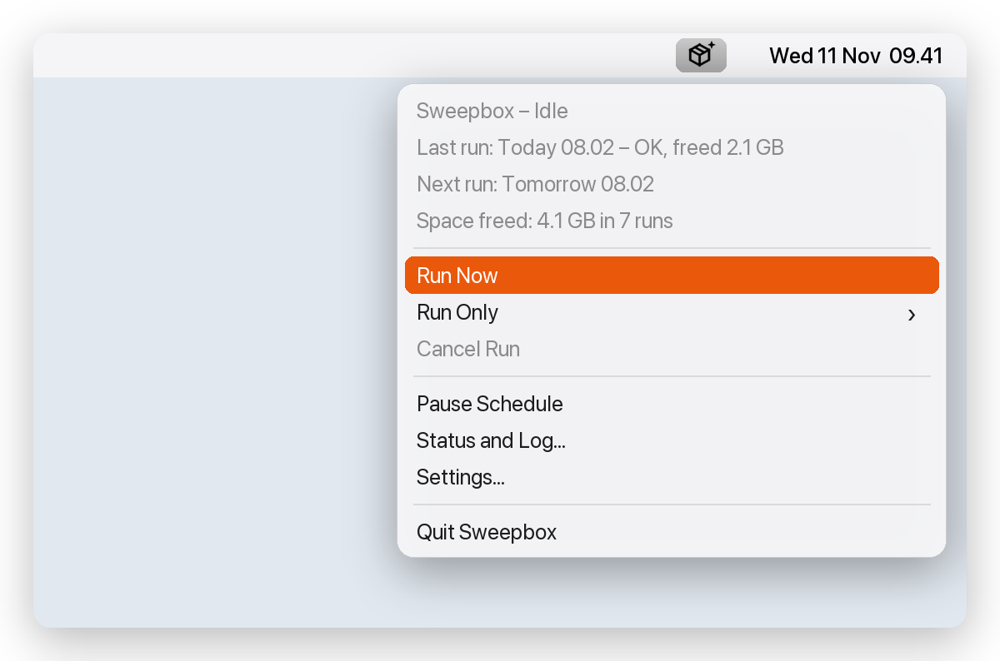
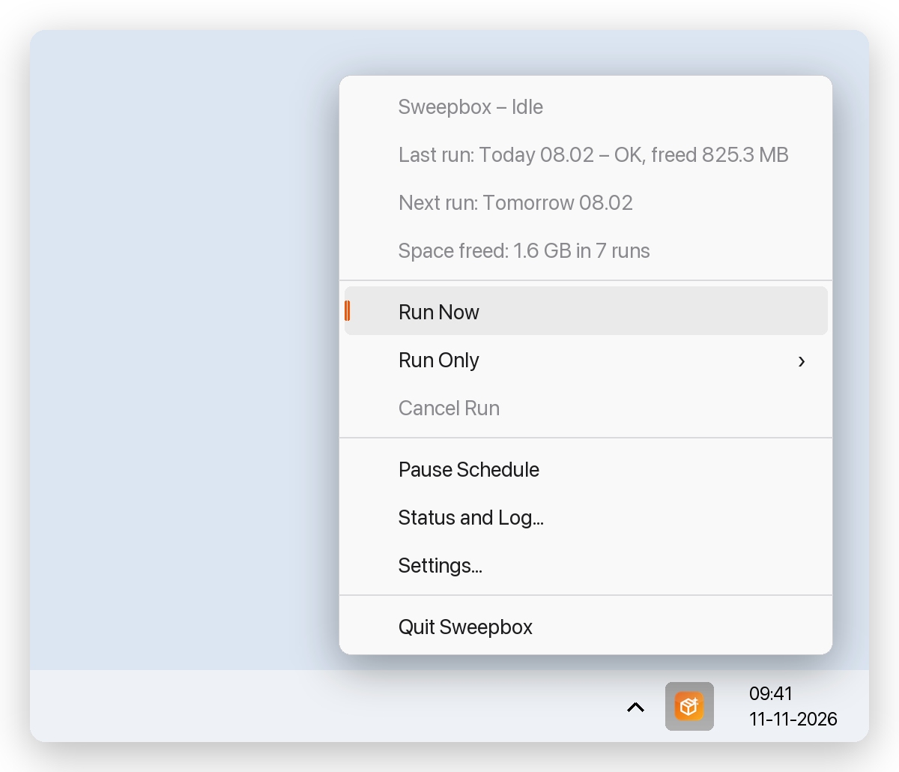
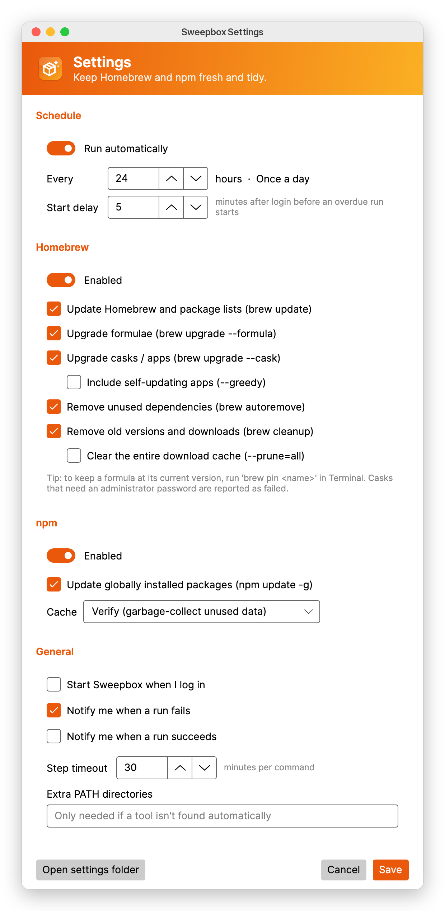
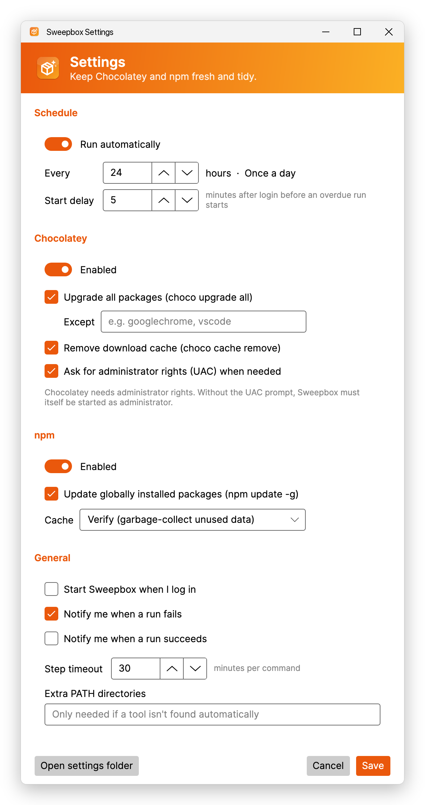
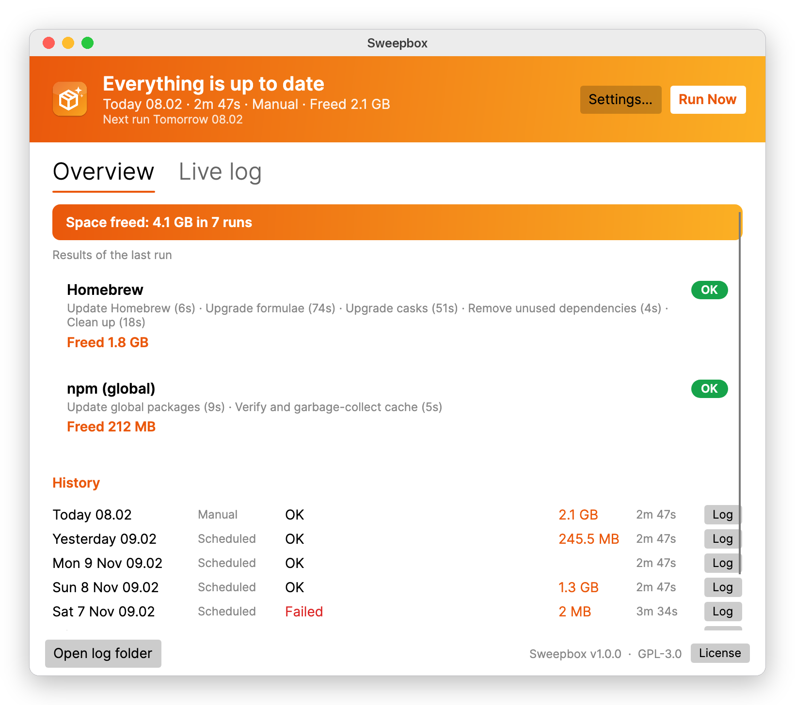
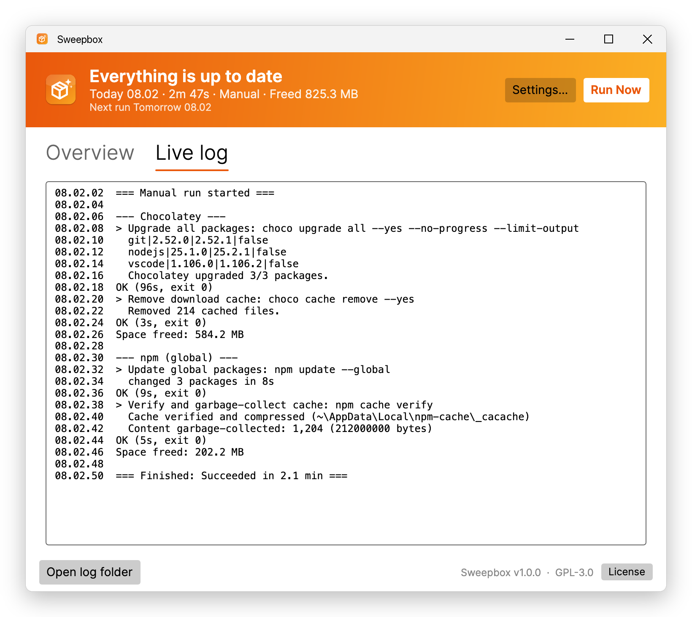

# Sweepbox manual

Sweepbox keeps your package managers up to date and tidy, on a schedule, from the menu bar (macOS) or the system tray (Windows):

| | macOS | Windows |
|---|---|---|
| **Homebrew** | update, upgrade formulae and casks, remove unused dependencies, clean up | – |
| **Chocolatey** | – | upgrade all packages, remove the download cache |
| **npm** | update global packages, verify or clear the cache | same |

Every cleanup step measures how much disk space it frees, so you can see what Sweepbox saves you.

- [Installing](#installing)
- [The menu bar and tray menu](#the-menu-bar-and-tray-menu)
- [Settings](#settings)
- [The status window](#the-status-window)
- [Space freed](#space-freed)
- [Command line](#command-line)
- [Files and folders](#files-and-folders)
- [Troubleshooting](#troubleshooting)
- [Uninstalling](#uninstalling)
- [License](#license)

---

## Installing

### macOS

1. Open `Sweepbox-<version>-macos-arm64.dmg` (Apple Silicon) or `…-x64.dmg` (Intel).
2. Drag **Sweepbox** onto **Applications**.
3. Start Sweepbox from Applications. It has no Dock icon; look for the parcel icon in the menu bar.

> **First launch of an unsigned build:** if macOS says the app "can't be opened", right-click it in Applications and choose **Open**, or run
> `xattr -dr com.apple.quarantine /Applications/Sweepbox.app` once.

### Windows

1. Run `Sweepbox-<version>-windows-x64-setup.exe` (or `arm64` for Windows on Arm).
2. The installer installs for the current user by default (no administrator needed) and can start Sweepbox when you sign in.
3. Sweepbox appears in the notification area. Windows may hide new tray icons behind the **˄** arrow; drag the icon onto the taskbar to keep it visible.

On first start Sweepbox opens **Settings** so you can review what it will do. Nothing runs until the start delay has passed (5 minutes by default) or you click **Run Now**.

---

## The menu bar and tray menu

<table>
<tr>
<th>macOS: click the parcel icon in the menu bar</th>
<th>Windows: right-click the tray icon (left-click opens the status window)</th>
</tr>
<tr>
<td>
<picture>
  <source media="(prefers-color-scheme: dark)" srcset="images/menu-macos-dark.png">
  
</picture>
</td>
<td>
<picture>
  <source media="(prefers-color-scheme: dark)" srcset="images/menu-windows-dark.png">
  
</picture>
</td>
</tr>
</table>

The top of the menu is a status summary:

| Line | Meaning |
|---|---|
| **Sweepbox – Idle / Running** | What Sweepbox is doing right now, including the current step while running |
| **Last run** | When the last run happened, its result and the space it freed |
| **Next run** | When the next scheduled run starts, or *paused* / *schedule off* |
| **Space freed** | Total space freed by cleanup across the remembered runs (only shown once cleanup has run) |

| Command | What it does |
|---|---|
| **Run Now** | Starts a full run with your settings |
| **Run Only ▸** | Runs a single package manager (even if it is disabled in Settings) |
| **Cancel Run** | Stops the current command and skips the rest |
| **Pause Schedule** | Temporarily stops scheduled runs (until you un-pause or restart Sweepbox) |
| **Status and Log…** | Opens the [status window](#the-status-window) |
| **Settings…** | Opens [Settings](#settings) |
| **Quit Sweepbox** | Quits; a running run is cancelled |

The icon shows the state at a glance:

| | Idle | Running | Last run failed |
|---|---|---|---|
| macOS |  |  |  |
| Windows |  |  |  |

On macOS the icon automatically turns white on a dark menu bar.

---

## Settings

Settings only shows the package managers available on your platform. Changes take effect when you click **Save**.

<table>
<tr><th>macOS</th><th>Windows</th></tr>
<tr>
<td valign="top">
<picture>
  <source media="(prefers-color-scheme: dark)" srcset="images/settings-macos-dark.png">
  
</picture>
</td>
<td valign="top">
<picture>
  <source media="(prefers-color-scheme: dark)" srcset="images/settings-windows-dark.png">
  
</picture>
</td>
</tr>
</table>

### Schedule

- **Run automatically**: turn off to only run when you click *Run Now*.
- **Every … hours**: the interval between runs (1 hour to 30 days; 24 = once a day). The next run is due this long after the previous one *started*.
- **Start delay**: minutes to wait after Sweepbox starts (for example at login) before an overdue run may begin, so your computer isn't busy the moment you sign in.

Sweepbox checks once a minute whether a run is due, so if your computer was asleep at the scheduled time, the run starts shortly after it wakes.

### Homebrew (macOS)

| Option | Command |
|---|---|
| Update Homebrew and package lists | `brew update` |
| Upgrade formulae | `brew upgrade --formula` |
| Upgrade casks / apps | `brew upgrade --cask` |
| ↳ Include self-updating apps | adds `--greedy` (apps like browsers that normally update themselves) |
| Remove unused dependencies | `brew autoremove` |
| Remove old versions and downloads | `brew cleanup` |
| ↳ Clear the entire download cache | adds `--prune=all` |

To keep a formula at its current version, pin it in Terminal: `brew pin <name>`.

### Chocolatey (Windows)

| Option | Command |
|---|---|
| Upgrade all packages | `choco upgrade all --yes` |
| ↳ Except | comma-separated package ids to leave alone, e.g. `googlechrome, vscode` |
| Remove download cache | `choco cache remove` |
| Ask for administrator rights (UAC) | Chocolatey needs admin rights. With this on, Windows asks for permission for each Chocolatey command. With it off, start Sweepbox itself as administrator. |

### npm

| Option | Command |
|---|---|
| Update globally installed packages | `npm update --global` |
| Cache: *Verify* | `npm cache verify`: checks the cache and removes unused data (recommended) |
| Cache: *Clear completely* | `npm cache clean --force`: empties the cache; the next installs download everything again |

### General

- **Start Sweepbox when I log in**: adds a login item (macOS LaunchAgent / Windows *Run* entry).
- **Notify me when a run fails / succeeds**: system notifications with a summary, including space freed.
- **Step timeout**: a command running longer than this is stopped and reported as failed.
- **Extra PATH directories**: only needed if Sweepbox reports a tool as *not found* although it is installed (see [Troubleshooting](#troubleshooting)).

---

## The status window

Open it from the menu (**Status and Log…**) or, on Windows, by left-clicking the tray icon.

<picture>
  <source media="(prefers-color-scheme: dark)" srcset="images/status-macos-dark.png">
  
</picture>

- **Header**: the result of the last run, when it ran, how long it took and how much space it freed, plus the next scheduled run. **Run Now** starts a run; while running it becomes **Cancel**.
- **Space freed**: the total across the remembered runs.
- **Results of the last run**: one card per package manager with its steps, outcome and freed space. Failures show which step failed and why.
- **History**: the last 15 runs, with outcome, space freed and duration. **Log** opens that run's log file.

The **Live log** tab follows the current run line by line (or shows the last run's log when idle):

<picture>
  <source media="(prefers-color-scheme: dark)" srcset="images/status-log-windows-dark.png">
  
</picture>

---

## Space freed

When a cleanup step is enabled (Homebrew *autoremove* / *cleanup*, npm cache *verify* / *clear*, Chocolatey *remove download cache*), Sweepbox measures the size of the folders those steps clean, right before the first cleanup step and again after the last one:

| Manager | Measured folders |
|---|---|
| Homebrew | the download cache (`brew --cache`), `Cellar` and `Caskroom` |
| npm | the npm cache (`npm config get cache`) |
| Chocolatey | Chocolatey's folder in the user and system TEMP folders |

The difference is shown as **Freed …** in the status window, the menu, the notification and the log. Upgrades happen *before* the first measurement, so new versions don't reduce the number. When no cleanup step is enabled, no space figure is shown.

Sizes use decimal units on macOS (1 GB = 1000 MB, like Finder) and binary units on Windows (1 GB = 1024 MB, like Explorer).

---

## Command line

The same executable has a command-line mode:

```
Sweepbox --dry-run   # show which commands a run would execute and where each tool was found
Sweepbox --run       # run once without UI; exit code 0 = success (for your own cron job / task)
Sweepbox --help
```

On macOS the executable is `/Applications/Sweepbox.app/Contents/MacOS/Sweepbox`. `--run` refuses to start while the menu bar app is running.

---

## Files and folders

| | macOS | Windows |
|---|---|---|
| Settings and run history | `~/Library/Application Support/Sweepbox/` | `%APPDATA%\Sweepbox\` |
| Log of each run (last 60 kept) | `…/Sweepbox/logs/` | `…\Sweepbox\logs\` |
| Login item | `~/Library/LaunchAgents/dk.sweepbox.agent.plist` | `HKCU\Software\Microsoft\Windows\CurrentVersion\Run\Sweepbox` |

`settings.json` is plain JSON and can be edited while Sweepbox is not running. Settings from the app's previous name (PkgCleaner) are moved over automatically.

---

## Troubleshooting

**"'brew' / 'npm' not found on PATH"**
On macOS Sweepbox reads your PATH from your login shell (`~/.zprofile`, `~/.zshrc`), which covers Homebrew, nvm, fnm and Volta. If a tool is still not found, run `which npm` in Terminal and add that folder under *Settings → Extra PATH directories*. `Sweepbox --dry-run` shows where each tool was found.

**A Homebrew cask fails with a password prompt**
Some casks need an administrator password to upgrade. Sweepbox never waits for input, so the step is reported as failed instead of hanging. Upgrade that cask once in Terminal (`brew upgrade --cask <name>`).

**Chocolatey fails: "not running from an elevated command shell"**
Turn on *Ask for administrator rights (UAC)* in Settings, or start Sweepbox as administrator. If you decline the UAC prompt, the run reports *Administrator permission was declined*.

**A step was stopped after 30 minutes**
Raise *Step timeout* in Settings, for example when large casks or packages download slowly.

**Where can I see exactly what happened?**
*Status and Log… → History → Log*, or the logs folder (see [Files and folders](#files-and-folders)).

---

## Uninstalling

**macOS**: quit Sweepbox from its menu, then delete `/Applications/Sweepbox.app`. To remove all data, also delete `~/Library/Application Support/Sweepbox` and `~/Library/LaunchAgents/dk.sweepbox.agent.plist`.

**Windows**: *Settings → Apps → Installed apps → Sweepbox → Uninstall*. Logs are removed; your settings stay in `%APPDATA%\Sweepbox` in case you reinstall.

---

## License

Sweepbox is free and open source software, licensed under the [GNU General Public License v3.0](../LICENSE). The license is shown by the Windows installer, shipped with the app (*Status window → License*) and included in the repository.
